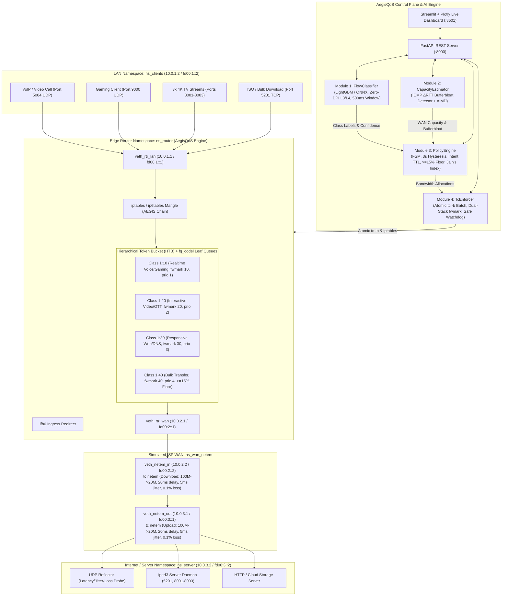

# AegisQoS: Intent-Aware, Zero-DPI Adaptive Linux QoS Engine for Mixed Home Broadband Traffic

**Tata Elxsi TELIPORT Season 4 — Case Study 3: Adaptive QoS Engine for Mixed Home Broadband Traffic**  
**Team:** CS-02  
**Members:** Chhayansh Porwal & Stuti Bharadia  
**Institution:** Rajasthan Technical University, Kota  

---

## 1. Executive Summary

Residential broadband connections concurrently handle diverse, competing traffic classes: latency-critical video conferencing and competitive gaming, jitter-sensitive VoIP, high-bitrate adaptive video streaming (4K OTT), bursty web browsing, and bulk downloads / cloud backups. Static priority queues often fail: they either starve bulk traffic or allow bufferbloat to balloon interactive packet latency.

**AegisQoS** is a reference Linux Quality of Service (QoS) engine designed for next-generation residential gateways (CPEs / RDK-B). It delivers closed-loop adaptive QoS through:
1. **Zero-DPI Statistical Flow Classification (Module 1):** Classifies traffic into 4 classes without inspecting L7 payloads using a 500 ms sliding-window LightGBM model exported to ONNX Runtime with confidence gating ($\ge 0.65$) and deterministic heuristic fallback.
2. **Passive/Active ICMP $\Delta$RTT Link Capacity Estimator (Module 2):** Continuously monitors round-trip times to detect bufferbloat ($\text{RTT} > 2 \times \text{baseline}$) and uses an AIMD algorithm to dynamically track available WAN capacity.
3. **Intent-Aware FSM Policy Engine (Module 3):** Dynamically computes bandwidth allocations across active traffic classes, enforces a strict 3-second hysteresis lock to prevent policy oscillation, supports temporary **User Intents with Time-to-Live (TTL)**, guarantees a $\ge 15\%$ starvation floor for bulk transfers, and calculates Jain's Fairness Index.
4. **Atomic Linux Traffic Control Enforcer (Module 4):** Generates atomic `tc -b` batches configuring a 4-class Hierarchical Token Bucket (HTB) with `fq_codel` leaf queues (`limit 1024 target 5ms interval 100ms ecn`) and dual-stack (`iptables` / `ip6tables`) packet marking (`fwmark`). Includes a Safe-State Watchdog that immediately rolls back to `fq_codel` if CPU $> 10\%$ or anomalies occur.
5. **Interactive Dashboard & REST API (Module 5):** FastAPI REST backend exposing `/status`, `/intent`, `/override`, `/rollback`, and `/metrics`, accompanied by a Streamlit + Plotly real-time visualization dashboard.

---

## 2. System Architecture



---

## 3. Key Technical Innovations & Compliance

1. **Zero Payload Decryption (Zero-DPI):**  
   Respects user privacy and TLS 1.3 encryption. Only inspects L3/L4 packet metadata: packet length mean & standard deviation, inter-arrival time mean & standard deviation, packet count per 500 ms sliding window, protocol ID, and 5-tuple hash.
2. **True Bidirectional Shaping:**  
   In Linux network namespaces:
   - Download traffic traverses `ns_server` $\to$ `ns_wan_netem` $\to$ `ns_router` $\to$ `ns_clients`. Inside `ns_router`, downstream shaping is applied to `veth_rtr_lan`, while WAN download impairment is applied to `veth_netem_in`.
   - Upload traffic exits `veth_rtr_wan` inside `ns_router` and `veth_netem_out` inside `ns_wan_netem`.
   - `ifb0` (Intermediate Functional Block) is attached to `veth_rtr_wan` for ingress redirection.
3. **No Offloading Distortions:**  
   `ethtool -K <iface> tx off rx off tso off gso off gro off` is applied across all 6 veth endpoints to prevent kernel packet aggregation from invalidating netem queuing.
4. **Dual-Stack IPv4 & IPv6 Parity:**  
   All interfaces, routing tables, iptables/ip6tables mangle rules (`fwmark 10, 20, 30, 40`), and `tc filter` rules (`protocol ip` and `protocol ipv6`) are configured with identical dual-stack priority.
5. **Atomic Execution & Safe-State Rollback:**  
   TC configurations are compiled into batch files and executed via `tc -b <batchfile>`. Any syntax error, timeout, or Watchdog trigger (CPU $> 10\%$ or anomalous packet drop) immediately rolls back both interfaces to safe-state `fq_codel`.

---

## 4. Repository Structure

```text
aegis-qos/
├── README.md                        # Master setup, architecture & verification guide
├── KNOWN_LIMITATIONS.md             # Boundary: prototype vs production (RDK-B, eBPF, TR-369)
├── LICENSES.md                      # Open-source license inventory (MIT, BSD-3, GPLv2)
├── config.example.env               # Fictitious example configuration tokens
├── requirements.txt                 # Python dependencies
├── models/                          # Pre-trained ONNX and LightGBM model weights
│   ├── classifier_metadata.json
│   ├── flow_classifier.onnx
│   └── flow_classifier_lgbm.pkl
├── scripts/
│   ├── setup_testbed.sh             # Idempotent 4-namespace dual-stack testbed setup
│   ├── teardown_testbed.sh          # Complete teardown of virtual links and namespaces
│   ├── set_wan_impairment.sh        # Dynamic tc netem updater for ns_wan_netem
│   └── run_benchmarks.sh            # 1-click automated benchmark runner
├── src/
│   ├── models/
│   │   ├── train_classifier.py      # Synthetic L3/L4 training & ONNX export pipeline
│   │   └── flow_classifier.py       # Module 1: 500ms sliding-window statistical classifier
│   ├── estimator/
│   │   └── capacity_estimator.py    # Module 2: ICMP ΔRTT bufferbloat & AIMD estimator
│   ├── policy/
│   │   └── policy_engine.py         # Module 3: FSM controller, Intent TTL, >=15% floor
│   ├── enforcement/
│   │   └── tc_enforcer.py           # Module 4: Atomic tc -b HTB enforcer & watchdog
│   ├── traffic/
│   │   └── scenario_generator.py    # Master scenario traffic generator & metrics logger
│   ├── api/
│   │   └── server.py                # Module 5a: FastAPI REST server
│   └── dashboard/
│       └── app.py                   # Module 5b: Streamlit + Plotly live dashboard
├── tests/
│   ├── test_modules.py              # Unit & integration tests for modules 1-4 (38 tests)
│   └── test_api_and_traffic.py      # Unit tests for FastAPI endpoints & scenarios (9 tests)
└── results/                         # Generated CSV metrics, JSON summaries, and HTML charts
    ├── benchmark_metrics.csv
    ├── benchmark_summary.json
    ├── BENCHMARK_REPORT.md
    ├── scenario1_rtt_comparison.html
    ├── scenario2_wan_adaptation.html
    └── scenario3_fairness_gaming.html
```

---

## 5. Prerequisites & Environment Setup

### Verified Operating Environment
- **OS:** Ubuntu 24.04 LTS (Kernel: Linux 6.8.0-147-generic)
- **Python:** 3.12.3
- **Network Utilities:** `iproute2` (v6.8.0), `iperf3` (v3.16), `ethtool`, `iptables`, `ip6tables`

### Installation Steps

1. **Clone the repository:**
   ```bash
   git clone https://github.com/Team-CS-02/aegis-qos.git
   cd aegis-qos
   ```

2. **Install Python virtual environment and dependencies:**
   ```bash
   python3 -m venv aegis-venv
   source aegis-venv/bin/activate
   pip install -r requirements.txt
   ```

3. **Configure Environment:**
   ```bash
   cp config.example.env .env
   ```

4. **Initialize Testbed Namespaces:**
   ```bash
   sudo bash scripts/setup_testbed.sh
   ```
   *Verification:*
   ```bash
   # Test dual-stack ping from ns_clients to ns_server
   sudo ip netns exec ns_clients ping -c 3 10.0.3.2
   sudo ip netns exec ns_clients ping -6 -c 3 fd00:3::2
   ```

---

## 6. Verification & Automated Test Suite

AegisQoS includes a comprehensive pytest suite covering all modules, edge conditions, invalid state transitions, and safe-state rollbacks:

```bash
sudo /home/ubuntu/aegis-venv/bin/python -m pytest tests/ -v
```

**Results:**
```text
tests/test_api_and_traffic.py::TestApiServer::test_health_endpoint PASSED
tests/test_api_and_traffic.py::TestApiServer::test_status_endpoint PASSED
tests/test_api_and_traffic.py::TestApiServer::test_intent_lifecycle PASSED
tests/test_api_and_traffic.py::TestApiServer::test_intent_invalid_class PASSED
tests/test_api_and_traffic.py::TestApiServer::test_manual_override_api PASSED
tests/test_api_and_traffic.py::TestApiServer::test_rollback_api PASSED
tests/test_api_and_traffic.py::TestApiServer::test_metrics_api PASSED
tests/test_api_and_traffic.py::TestScenarioHelpers::test_probe_stats_calculation PASSED
tests/test_api_and_traffic.py::TestScenarioHelpers::test_jains_fairness_calculation PASSED
tests/test_modules.py::TestFlowClassifier::test_confidence_in_range PASSED
tests/test_modules.py::TestFlowClassifier::test_onnx_classification PASSED
tests/test_modules.py::TestFlowClassifier::test_deterministic_fallback_threshold PASSED
tests/test_modules.py::TestFlowClassifier::test_deterministic_fallback_no_model PASSED
tests/test_modules.py::TestFlowClassifier::test_deterministic_fallback_rules PASSED
tests/test_modules.py::TestFlowClassifier::test_manual_override PASSED
tests/test_modules.py::TestFlowClassifier::test_manual_override_clear PASSED
tests/test_modules.py::TestFlowClassifier::test_macro_f1_gate PASSED
tests/test_modules.py::TestCapacityEstimator::test_initial_state PASSED
tests/test_modules.py::TestCapacityEstimator::test_rtt_update PASSED
tests/test_modules.py::TestCapacityEstimator::test_bufferbloat_detection PASSED
tests/test_modules.py::TestCapacityEstimator::test_aimd_additive_increase PASSED
tests/test_modules.py::TestCapacityEstimator::test_aimd_multiplicative_decrease PASSED
tests/test_modules.py::TestCapacityEstimator::test_rate_bounds PASSED
tests/test_modules.py::TestCapacityEstimator::test_get_state PASSED
tests/test_modules.py::TestCapacityEstimator::test_live_ping PASSED
tests/test_modules.py::TestPolicyEngine::test_initial_state PASSED
tests/test_modules.py::TestPolicyEngine::test_valid_transitions PASSED
tests/test_modules.py::TestPolicyEngine::test_invalid_transition PASSED
tests/test_modules.py::TestPolicyEngine::test_emergency_bypass PASSED
tests/test_modules.py::TestPolicyEngine::test_emergency_recovery PASSED
tests/test_modules.py::TestPolicyEngine::test_hysteresis_lock PASSED
tests/test_modules.py::TestPolicyEngine::test_hysteresis_emergency_bypass PASSED
tests/test_modules.py::TestPolicyEngine::test_bulk_starvation_floor PASSED
tests/test_modules.py::TestPolicyEngine::test_allocations_sum_to_wan_rate PASSED
tests/test_modules.py::TestPolicyEngine::test_user_intent_ttl PASSED
tests/test_modules.py::TestPolicyEngine::test_jains_fairness_index PASSED
tests/test_modules.py::TestPolicyEngine::test_get_state PASSED
tests/test_modules.py::TestTcEnforcer::test_batch_generation PASSED
tests/test_modules.py::TestTcEnforcer::test_batch_dual_stack_filters PASSED
tests/test_modules.py::TestTcEnforcer::test_batch_fwmark_values PASSED
tests/test_modules.py::TestTcEnforcer::test_atomic_apply_and_rollback PASSED
tests/test_modules.py::TestTcEnforcer::test_rollback_increments_count PASSED
tests/test_modules.py::TestTcEnforcer::test_get_state PASSED
tests/test_modules.py::TestTcEnforcer::test_tc_stats_query PASSED
tests/test_modules.py::TestIntegration::test_classifier_to_policy_flow PASSED
tests/test_modules.py::TestIntegration::test_policy_to_enforcer_flow PASSED
tests/test_modules.py::TestIntegration::test_full_pipeline_shaping PASSED

======================== 47 passed in 3.58s =========================
```

---

## 7. Running Real-Packet Benchmarks (1-Click)

To execute all three Case Study scenarios across **Baseline** (unmanaged), **Deterministic** (static DiffServ), and **AegisQoS** (adaptive AI), run:

```bash
sudo bash scripts/run_benchmarks.sh
```

### Evaluated Scenarios:
1. **Scenario 1 (ISO Download + Video Call):**  
   A high-throughput TCP bulk transfer (`iperf3`) saturates the link while an active VoIP/Video call (50 Hz UDP probe) is ongoing. Demonstrates queue isolation, protection of call latency, and preservation of the $\ge 15\%$ bulk progress floor.
2. **Scenario 2 (Dynamic WAN Drop 100M $\to$ 20M):**  
   Simulates sudden last-mile broadband degradation by dynamically updating `tc netem` on `ns_wan_netem`. Demonstrates bufferbloat detection and AIMD shaping recalculation within 3 seconds.
3. **Scenario 3 (3 TV Streams + 1 Gaming Device):**  
   Three concurrent video streams (ports 8001–8003) run alongside high-frequency UDP gaming traffic (port 9000). Evaluates Jain's Fairness Index across the video streams while preserving gaming latency.

---

## 8. Launching the Live Dashboard & REST API

### Start the REST API:
```bash
sudo /home/ubuntu/aegis-venv/bin/python -m uvicorn src.api.server:app --host 0.0.0.0 --port 8000
```

### Start the Streamlit Dashboard:
```bash
/home/ubuntu/aegis-venv/bin/streamlit run src/dashboard/app.py --server.port 8501
```
Open `http://localhost:8501` to view live RTT, jitter, loss, queue depth, throughput allocations, and interactive User Intent controls.

---

## 9. License

This project is licensed under the MIT License. See [LICENSES.md](LICENSES.md) for full license text and third-party notices.
